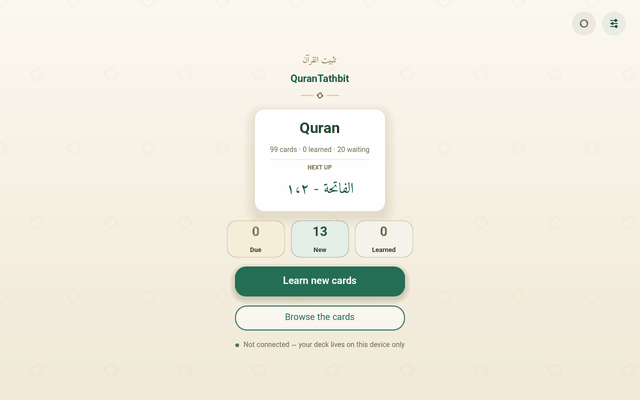

# QuranTathbit

A calm app for memorising the Quran. Each day it shows you the cards that
are due — a verse, its Persian translation, and its recitation — and asks
how it went. Cards you found hard come back sooner, easy ones later.

It ships with 99 cards from Al-Fātiḥah and Al-Baqarah. Everything is in
Arabic and Persian, set in proper Quranic typefaces.

No streaks, no notifications, no account needed. The app invites; it never
pushes.

## ▶️ Use it in your browser

### **[▶️ Open QuranTathbit](https://mlibre.github.io/QuranTathbit/)**

Nothing to install. It opens like any website and works offline after the
first visit. To keep it on your phone like a normal app, use your
browser's menu: **Install app** (Chrome, Edge) or **Add to Home Screen**
(Safari).

## ⬇️ Download it instead

Grab a build from the [**Releases**](https://github.com/mlibre/QuranTathbit/releases) page:

| Platform    | File                                             | How to run                                           |
| ----------- | ------------------------------------------------ | ---------------------------------------------------- |
| **Windows** | `QuranTathbit-Windows.zip` → `QuranTathbit.exe`  | unzip anywhere, double-click                         |
| **Linux**   | `QuranTathbit-Linux.zip` → `QuranTathbit.x86_64` | `chmod +x`, then run                                 |
| **Android** | `QuranTathbit-Android.apk`                       | sideload; allow installs from this source when asked |

No installer, no dependencies. The download *is* the app.

## How a day works

1. **Home** shows how many cards wait today, and one big **Study** button.
2. A **question** appears: the surah and verse, set large in the middle of
   the page. Press **Space** or **Show answer** when you are ready.
3. The **answer** shows the verse again with its Persian translation, and
   each verse can be played — in Arabic, or spoken in Persian. Four
   buttons ask how it went: **Again**, **Hard**, **Good**, **Easy**. Each
   button says when the card will come back.
4. When the queue is empty, the app says so. Come back tomorrow.

A few quiet extras:

- **Edit anything, anywhere.** The pencil on a card opens a simple editor;
  the words are saved as plain files. Spotted a typo mid-session? Fix it
  mid-session.
- **Browse the whole deck like a book.** Every verse on the page, flush
  right the way the Quran is read, with search (`2:93` or `۲:۹۳` — either
  digits work) and filters for what is due, new, or resting.
- **Set your own pace.** Settings → *New cards each day* (default 20, set
  it to 0 for review-only days).
- **Choose the verse's typeface.** Settings → *Reading*: **Amiri Quran**
  (the default), **Amiri**, or **Noto Naskh Arabic** — each shown by its own
  drawing of the Basmala, so you choose with your eyes. Your pick follows
  the deck to every device.
- **The app speaks your language.** Menus and messages in English, فارسی or
  العربية — asked once the first time you open the app, changeable anytime
  in Settings. The verses and their Persian translation always stay exactly
  as they are.
- **Copy any verse or translation** — drag or long-press, and paste it
  anywhere.

## Your progress, kept safe

Your deck can live in **your own private GitHub repository** — free, and
yours. Press **Connect GitHub** in Settings, follow the short sign-in, and
the app keeps everything in step: study on your phone, and the same deck
waits on your computer. If two devices study apart from each other, both
keep their work when they meet again. Not interested? Everything also
works fully offline, forever, on one device.

## Keyboard shortcuts

| Key                   | What it does                                   |
| --------------------- | ---------------------------------------------- |
| **Space** / **Enter** | show the answer, then answer **Good**          |
| **1** – **4**         | answer **Again**, **Hard**, **Good**, **Easy** |
| **Esc**               | close the session                              |

While editing a card: **Esc** closes without saving, **Ctrl+Enter** saves.

## Credits

- **Card data** — verses, Persian translation, and recitations from
  [quran.makarem.ir](https://quran.makarem.ir); no other source is used.
- **Code** — MIT; **algorithm** — SM-2 (the same spaced-repetition math
  Anki uses). Both attributions live in the [LICENSE](LICENSE).
- **Typefaces** — Amiri Quran for the verses, Amiri for references, Noto
  Naskh Arabic as the reader's alternative, Vazirmatn for Persian — all from
  Google Fonts, each under its SIL OFL license in `assets/fonts/`.

## For developers

[AGENTS.md](AGENTS.md) holds the design rules, [docs/TESTING.md](docs/TESTING.md)
the test battery, [docs/OAUTH_SETUP.md](docs/OAUTH_SETUP.md) your own GitHub
app, [docs/README.npm.md](docs/README.npm.md) the npm package. To run from
source: `godot --headless --path . --import`, then open the project and
press F5.

## 🇵🇸 In Support of Palestine

This project supports Palestine. If you can, donate to [UNRWA](https://www.unrwa.org).

The people of Palestine endure daily suffering and loss, too often unseen and
unhelped. They are asking for support — and we can give our voice, our care,
and our help. Even a small act can matter. Please do what you can. 🤲

And if you ever doubt what is right and what is wrong, remember: when someone
kills a baby to loot baby’s belongings, he is the devil — and he stands on the
wrong side. ✊
