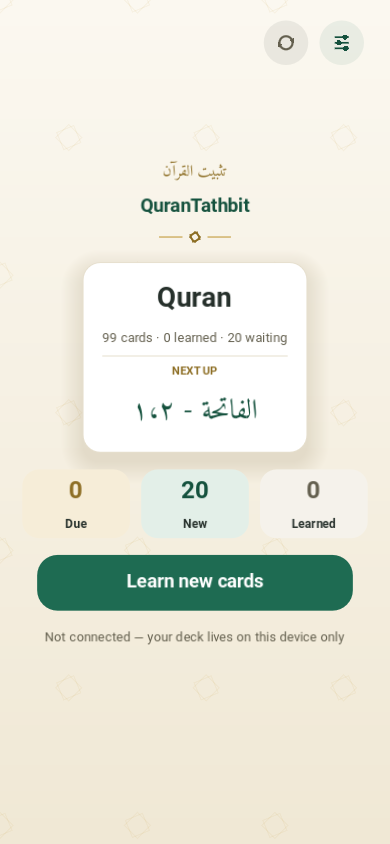
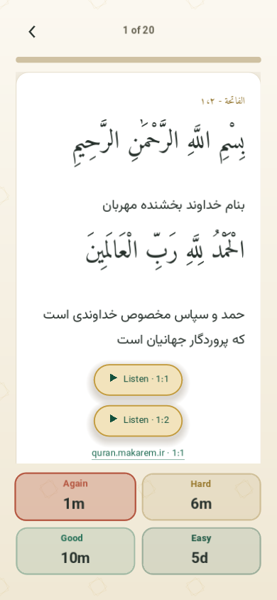

# QuranTathbit

A friendly app for memorising the Quran. Study the cards the app has prepared for you, mark how well it went, and come back tomorrow.

The deck ships with the app: cards from Al-Fātiḥah and Al-Baqarah, each one a verse, its Persian translation, and a recitation. Cards you found hard come back sooner, easy ones later — so each day you sit down to exactly what is due that day.

No streaks, no notifications: the app invites, it never pushes, and cards you miss simply wait.

## ▶️ Play it in your browser

### **[▶️ Open QuranTathbit](https://mlibre.github.io/QuranTathbit/)**

Nothing to install, nothing to sign up for. Each recitation streams on
demand, and the app caches itself — after the first visit it opens instantly
and works offline, on any modern browser: desktop, tablet, or phone. A tab
or installed app left open hears about a new version on its own: a gold
button appears beside the others in the corner, and taking it swaps the page
in place — no refresh needed.

Want it on your home screen like any other app? Your browser's menu offers
**Install app** (Chrome, Edge) or **Add to Home Screen** (Safari, any
phone): it then opens full-screen and offline, with its own icon — no store,
no tab, no browser bars.

> In a browser you sign in with a one-minute token: press **Connect GitHub**
> and the app walks you through it — and pasting the token works the way it
> does everywhere else: **Ctrl+V** in the box, or hold the box on a phone.
> On desktop and Android the full device-code sign-in works.

## ⬇️ Download it for your computer

Grab a build from the [**Releases**](https://github.com/mlibre/QuranTathbit/releases) page:

| Platform    | File                                             | How to run                                           |
| ----------- | ------------------------------------------------ | ---------------------------------------------------- |
| **Windows** | `QuranTathbit-Windows.zip` → `QuranTathbit.exe`  | unzip anywhere, double-click                         |
| **Linux**   | `QuranTathbit-Linux.zip` → `QuranTathbit.x86_64` | `chmod +x`, then run                                 |
| **Android** | `QuranTathbit-Android.apk`                       | sideload; allow installs from this source when asked |

No installer, no dependencies, no account: the download *is* the app.

## A study session

On a phone the same session lays out for a hand — a phone's own page
width, two answer buttons to a row, every target a thumb tall:

  
  

1. **Home** — today's waiting count and one big **Study** button.
2. **Question** — the surah and āyāt in Arabic, set large in the middle of
   the page. Press **Space** (or **Show answer**) when you are ready.
3. **Answer** — the verse again, the Persian translation a step behind, and
   beside each verse's recitation its Persian translation, spoken — each
   pill saying which verse and which voice will speak. Four buttons ask how
   it went — **Again**, **Hard**, **Good**, **Easy** — each carrying its
   next interval as its biggest word, so the cost of each choice is
   visible up front. A typo noticed mid-study is fixed mid-study: the
   pencil in the corner opens the card's own page: the words written the way
   Arabic and Persian are read — every line flush right, the caret and the
   chosen words following the hand — with a **Read** switch beside the
   saving that lays the card out exactly as its reader will see it, both
   sides. It saves to the very files the deck is, and the next sync carries
   the edit to GitHub like any other.
4. **Rest** — when the queue is empty, the app says so and tells you to come
   back tomorrow. Progress is saved automatically.

Every verse, translation and explanation is selectable — drag, or long-press
on a touch screen — so you can paste any of it into your notes: the
selection rests in the page's own gold, never a browser-blue slab. The deck
is also a book: **Browse** under the day's button opens the whole library —
every card as a page of scripture in miniature, the verse itself large in
the mushaf typeface with its address above it, gathered under its surah's
own running head with a quiet green rule of how far through it you are.
The shelf answers its search field (the surah, the verse's own words, or
its address — `2:93`, `۲:۹۳`, the hand's own digits both) and its filter
pills (due today, not yet started, resting between reviews); a row opens in
place to read and listen, and the ↑/↓ keys walk the shelf like a list.

The day's pace is yours, not the algorithm's. Anki's deck default offers 20
new cards a day; **Settings → New cards each day** turns that number to your
own — including 0, for days meant for reviews only — and the home count and
the queue answer it at once.

## Sync, in plain words

On **Settings → Connect GitHub** the app shows a short code; you type it at
`github.com/login/device` and the app is signed in. The first sync creates a
private repository named `quran-tathbit` (renameable) and pushes the deck
there. After that, every sync is a three-way merge: what changed only here is
pushed, what changed only there is pulled, and what changed on both sides
keeps your local edit (for cards) or merges card by card (for progress).

Sync is quiet and it is cheap. It runs on its own after each session — the
status line under the day's button says what it is doing, and it can be
switched off in Settings — and a sync with nothing to say moves nothing at
all: no file is re-sent, none is re-fetched, and a run that finds everything
already in step asks two questions of the branch and stops. A sync the
network interrupts is retried on the app's own — each retry resuming from
wherever the last one landed — so an interrupted opening heals itself
without a hand on the button.

## Keyboard shortcuts

| Key                   | What it does                                   |
| --------------------- | ---------------------------------------------- |
| **Space** / **Enter** | show the answer, then answer **Good**          |
| **1** – **4**         | answer **Again**, **Hard**, **Good**, **Easy** |
| **Esc**               | close the session                              |

While editing a card: **Esc** closes without saving, **Ctrl+Enter** saves.
In the browser, keys the browser owns — **F5**, **F11**, **Ctrl+F** and
friends — keep working as on any other page.

## Credits

- **Card data** — verses, Persian translation, and recitations from
  [quran.makarem.ir](https://quran.makarem.ir); no other source is used.
  The Persian translation recitations are Hojatollah Kabiri's, from the
  site's own library (`persian-kabiri`), recorded in `deck.json`.
- **Code** — MIT; **algorithm** — SM-2. Both attributions live in the
  [LICENSE](LICENSE).
- **Typefaces** — Amiri Quran for the Arabic verses (the family's mushaf cut,
  whose vowel marks stay round at every size this app draws), Amiri for the
  references, Vazirmatn for the Persian text, each under its SIL OFL license
  in `assets/fonts/`.

## For developers

[AGENTS.md](AGENTS.md) holds the design rules, [docs/TESTING.md](docs/TESTING.md)
the test battery, [docs/OAUTH_SETUP.md](docs/OAUTH_SETUP.md) your own GitHub
app, [docs/README.npm.md](docs/README.npm.md) the npm package. To run from
source: `godot --headless --path . --import`, then open the project and
press F5.

## 🇵🇸 In Support of Palestine

This project supports Palestine. If you can, donate to [UNRWA](https://www.unrwa.org).

The people of Palestine endure daily suffering and loss, too often unseen and
unhelped. They are asking for support — and we can give our voice, our care,
and our help. Even a small act can matter. Please do what you can. 🤲

And if you ever doubt what is right and what is wrong, remember: when someone
kills a baby to loot baby’s belongings, he is the devil — and he stands on the
wrong side. ✊
