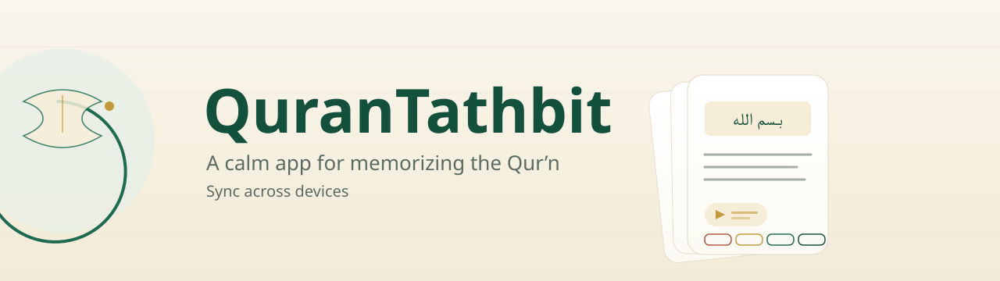

# QuranTathbit

<div align="center">



[](https://mlibre.github.io/QuranTathbit/)
[](https://github.com/mlibre/QuranTathbit/releases)
[](https://github.com/mlibre/QuranTathbit/actions/workflows/pages.yml)
[](https://www.npmjs.com/package/qurantathbit)


*A calm app for memorizing the Qur'an*<br/>
*Sync across devices*

</div>

The verses, the Persian translation, and the recitation of every card come
from [quran.makarem.ir](https://quran.makarem.ir) — and from nowhere else.
See the credits and the [LICENSE](LICENSE) for the full attribution.

## ▶️ Play it in your browser

The web build is published automatically — nothing to install, nothing to sign
up for:

### **[▶️ Open QuranTathbit](https://mlibre.github.io/QuranTathbit/)**

The page opens with a 1 MB app and streams each recitation from the site on
demand. The engine rides compressed — about 10 MB the first visit — and the
app then caches itself, so it opens instantly and works offline afterwards.
Runs on any modern browser — desktop, laptop, tablet, or phone.

> In a browser you sign in with a one-minute token: press **Connect GitHub**
> and the app walks you through it (GitHub's sign-in page cannot be opened
> from another site — a browser cannot change that, so the app opens the
> token form with everything prefilled instead). On desktop and Android the
> full device-code sign-in works.

## ⬇️ Download it for your computer

Grab a build from the
[**Releases**](https://github.com/mlibre/QuranTathbit/releases) page:

| Platform | File | How to run |
| --- | --- | --- |
| **Windows** | `QuranTathbit-Windows.zip` → `QuranTathbit.exe` | unzip anywhere, double-click |
| **Linux** | `QuranTathbit-Linux.zip` → `QuranTathbit.x86_64` | `chmod +x`, then run |
| **Android** | `QuranTathbit-Android.apk` | sideload; allow installs from this source when asked |

No installer, no dependencies, no account: the download *is* the app.

### Run from source

Any machine with [Godot 4.7](https://godotengine.org/download) can run the
project from this repository:

```bash
godot --headless --path . --import   # once, after a fresh clone
godot --path .                       # then open and press F5
```

### Use it through npm

For developers who prefer the npm route, the web build is also published as an
npm package — install it and serve it from anywhere:

```bash
npx qurantathbit        # downloads the web build and serves it at http://localhost:8080
```

or

```bash
npm install qurantathbit
node node_modules/qurantathbit/start.js
```

## About the app

- **One deck, no deck manager.** The deck ships with the app — 99 cards from
  Al-Fātiḥah and Al-Baqarah, each one a verse, its Persian translation, and a
  recitation. There is nothing to create, name, import, or browse. You study
  what is there.
- **Spaced repetition that learns how well you remember.** Each card knows
  when to come back: soon if it was hard, later if it was easy, with a small
  random nudge so the deck does not all return on the same day. The numbers
  follow the well-known SM-2 review algorithm; see the
  [LICENSE](LICENSE) for the attribution.
- **Cards are folders and files.** A deck is a folder; a card is a folder of
  plain markdown plus its media. No database, no proprietary format — every
  card is something you can read, edit, and diff in any editor on any machine.
- **Sync is your own GitHub repo.** Sign in with GitHub (the OAuth device
  flow, or a pasted token) and the deck lives in a private repository you
  own, as the same folders and files. Phone, laptop, and browser stay in step;
  the merge is card-by-card, so two devices that studied offline both keep
  their work when they meet.
- **The browser stays light.** The web build ships the deck's text in its app
  (about 1 MB), serves the engine compressed (about 10 MB the first visit)
  and streams each recitation from the site beside it. After the first visit
  the app is cached and opens offline.
- **Copy what you read.** Every verse, every translation, and every
  explanation on every screen is selectable — hold the mouse and drag, or
  long-press on a touch screen, the way every other reader works. Paste into
  your notes, your chat, anywhere.
- **Quiet by design.** No streaks, no leaderboards, no notifications shouting
  for attention. The home screen says how many cards are waiting and one
  button to start. That is the whole interface.

## How a study session feels

1. **Home** — the deck's name, today's waiting count, one big **Study** button.
2. **Question** — the front of the card: the surah and āyāt in Arabic, set in
   Amiri at a size you can read across the room, standing in the middle of
   the page. Press **Space** (or the **Show answer** button) when you are
   ready.
3. **Answer** — the back of the card: the verse in Amiri, large and set in
   its own room, the makarem.ir Persian translation following a step behind,
   and the recitation again, each button saying which verse will speak. The
   question's own reference rides along at the top, small and gold, so the
   verse is never read without knowing which one was asked for. Four buttons
   ask how it went — **Again**, **Hard**, **Good**, **Easy** — each carrying
   its next interval as the biggest word on the button, so the cost of each
   choice is visible before you make it.
4. **Rest** — when the queue is empty, a small card says so and tells you to
   come back tomorrow. Progress is saved automatically.

## Sync, in plain words

On **Settings → Connect GitHub** the app shows a short code; you type it at
`github.com/login/device` on any device you trust, and the app is signed in.
On the first sync it creates a private repository named `quran-tathbit`
(renameable) and pushes the deck. After that, every sync is a three-way merge:
what changed only here is pushed, what changed only there is pulled, what
changed on both sides keeps your local edit (for cards) or merges card by card
(for progress). Anything else in your repo is left alone.

A small overlay covers the screen while sync runs, with a plain phase ("Signing
in to GitHub", "Fetching what changed", …) and a progress bar that knows how
far along it is — so the first sync, which can take a minute against a fresh
repo, never looks frozen.

Forking the project and want your own GitHub app? Every field to fill into
the github.com form is written out in [docs/OAUTH_SETUP.md](docs/OAUTH_SETUP.md).

## Keyboard shortcuts

| Key | What it does |
| --- | --- |
| **Space** / **Enter** | show the answer, then answer **Good** |
| **1** – **4** | answer **Again**, **Hard**, **Good**, **Easy** |
| **Esc** | close the session |

In the browser, the tab still belongs to the browser: **F5** / **Ctrl+F5**
(reload), **F11** (fullscreen), **F12** / **Ctrl+Shift+I** (dev tools),
**Ctrl+L** (address bar), **Ctrl+F** (find) and friends work exactly as they
do on any other page. The app keeps only the keys it uses — Space, 1–4, Esc —
and hands everything the browser owns straight back to it.

## Credits

- **Card data** — the verses, the Persian translation, and the recitations
  come from [quran.makarem.ir](https://quran.makarem.ir), extracted from the
  public `quran-cards-2026-10-14.apkg` export. No other source is used for
  card content; `deck.json` records the source beside the cards it describes.
  See the attribution section of [LICENSE](LICENSE).
- **Code** — MIT, as laid out in [LICENSE](LICENSE).
- **Algorithm** — the SM-2 review scheduler; see the algorithm attribution
  section of [LICENSE](LICENSE).
- **Typefaces** — Amiri (Naskh, for the Arabic verses) and Vazirmatn (Persian
  sans, for the translations and the interface), each under its SIL OFL
  license in `assets/fonts/`.

## 🇵🇸 In support of Palestine

This project stands with Palestine. If you are able, please consider donating
to [UNRWA](https://www.unrwa.org) or a trusted aid organization of your
choice.

The people of Palestine endure daily suffering and loss, too often unseen and
unhelped. They are asking for support — and we can give our voice, our care,
and our help. Even a small act can matter. 🤲
